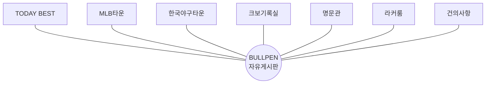
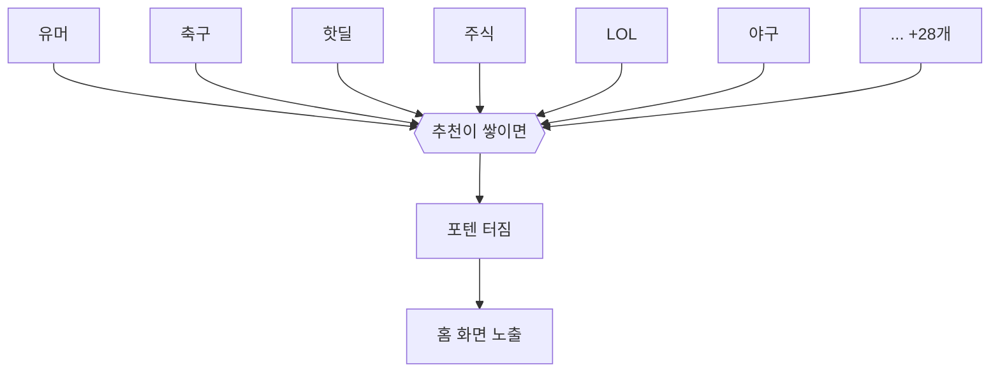
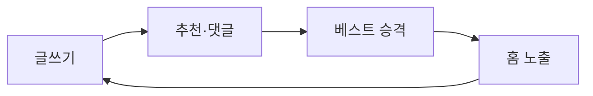

# 레퍼런스 리서치: MLBPARK vs 에펨코리아

- 분석일: 2026-11-13 (홈 화면 기준)
- 방법: REA 패시브 분석(브라우저 페이지 관찰, 스크립트 정적 분석)과 모바일 화면 HTML의 링크·스크립트 패턴 확인
- 시각화 버전: https://claude.ai/artifact/36kjs9vcS7KLTjs5yfQfVp (비공개)

표기: **[관찰]** 직접 확인 · **[추론]** 관찰을 근거로 한 해석 · **[미확인]** 이번 범위에서 보지 못함

---

## 1. 한눈에 비교

| 항목 | MLBPARK | 에펨코리아 |
|---|---|---|
| 구조 유형 | 허브형: 자유게시판(BULLPEN) 하나가 중심 | 깔때기형: 많은 게시판의 인기글이 "포텐 터짐"으로 모임 |
| 렌더링 | PHP 서버 렌더링 (`b.php`, `best.php`) [관찰] | 서버 렌더링, XE·라이믹스 계열 엔진 [추론] |
| 프론트 JS | jQuery, jQuery UI, jquery-cookie, Swiper [관찰] | 자체 번들 `core.js`, 지연 로딩, Swiper [관찰] |
| 게시판 식별 | 쿼리 `?b=bullpen` | 짧은 주소 `/politics`, 쿼리 `?mid=best` |
| 베스트 구조 | TODAY BEST, 명문관 | 포텐 터짐 (추천 누적으로 승격) |
| 메뉴 노출 게시판 | 10개 | 39개 (대분류 11 + 인기 게시판 28) |
| 실시간 요소 | 관찰되지 않음 | WebSocket 알림 주소, 실시간 키워드 순위 |
| 스팸 방지 | reCAPTCHA | reCAPTCHA + 자체 `ispam` 모듈 |
| 홈 DOM 노드 / 링크 | 2,184 / 241 | 3,437 / 318 |
| 접근성 랜드마크 | 없음 | banner, navigation, main, contentinfo |

---

## 2. 사이트별 구조

### MLBPARK: 허브형

- 메뉴: TODAY BEST, MLB타운, 한국야구타운, BULLPEN, 크보기록실, 라커룸, 명문관, 건의사항, 폰판기, 운세 [관찰]
- 모바일 홈의 글 링크 중 BULLPEN이 49개, 다른 게시판은 각 1개 [관찰]
- 상단에 선수 기록 연동 카드가 슬라이드로 붙음. 커뮤니티 글과 스포츠 데이터를 섞는 방식 [관찰]
- 스크립트는 언론사 공용 `donga.js`와 전용 `mp_func_v1.3.js`로 나뉨 [관찰]
- 개인정보처리방침이 `secure.donga.com`에 있어 회원 체계가 모회사 계정과 묶여 있을 가능성이 높음 [추론]

**배울 점:** 게시판을 늘리기보다 자유게시판 하나를 키우고, 주제 데이터(기록실)를 곁들여 체류 시간을 늘린다. 작은 커뮤니티의 출발점으로 현실적인 모델.

### 에펨코리아: 깔때기형

- 대분류: 포텐터짐, 유머/정보, 스포츠, 쇼핑/투자, 일반, 게임, 커뮤니티, 갤러리, 풋볼매니저, FC, 2군 [관찰]
- 그 아래 인기 게시판 28개 (유머, 축구소식, 핫딜, 주식, LOL, 야구, 부동산 등). 즐겨찾기와 "설정하기"로 사용자가 메뉴를 고름 [관찰]
- 정적 파일 경로가 `modules/board/skins/`, `widgets/`, `m.layouts/`로 나뉘고 글 식별자가 `document_srl` [관찰] → XE·라이믹스 계열 관례와 일치 [추론]
- 자체 모듈: `fmkeywordrank`(키워드 순위), `fmrecentvisited`(최근 방문 게시판), `ispam`(스팸 차단), `fmad`(광고) [관찰]
- 프론트 기능: 다크 모드, 모바일 당겨서 새로고침, 외부 링크 경고, 키보드 단축키(e/d 위아래, s/f 이전·다음, w 인기글) [관찰]
- 코드에 `wss://livealert.fmkorea.com` WebSocket 생성이 있음 [관찰]. 실제 연결 여부는 [미확인]
- 목록 카드에 분류(화제, 핫딜, 정보/기사 등), 추천 수, 댓글 수 `[N]` 표시, "최신 / 화제" 정렬 탭 [관찰]

**배울 점:** "포텐 터짐"이라는 승격 장치 하나가 전체 게시판을 묶는다. 어느 게시판에 써도 추천을 많이 받으면 메인에 오르므로, 게시판이 늘어나도 홈은 하나로 유지된다.

---

## 3. 공통 핵심 루프

형태는 달라도 루프는 같다. 베스트 승격이 글쓴이에게는 보상이고, 읽는 사람에게는 다시 올 이유다.

---

## 4. 주소 구조

| 사이트 | 형태 | 설명 |
|---|---|---|
| MLBPARK | `/mp/b.php?b=bullpen&m=view&id=N` | 게시판 ID · 모드(목록/보기) · 글 번호 |
| MLBPARK | `/mp/best.php`, `/mp/honor.php`, `/mp/dugout.php` | 베스트, 명문관, 더그아웃 |
| 에펨코리아 | `/politics`, `/best/N` | 짧은 게시판 주소, 짧은 글 주소 |
| 에펨코리아 | `/index.php?mid=...&sort_index=...&order_type=...&listStyle=...&page=N` | 정렬 · 텍스트/이미지 목록 · 페이지 |
| **우리 추천** | `/[board]/[id]` | 게시판 slug와 글 번호 |

---

## 5. 기술 구성

| 층 | MLBPARK | 에펨코리아 |
|---|---|---|
| 브라우저 | jQuery · jQuery UI · Swiper [관찰] | 자체 번들 `core.js` · 지연 로딩 [관찰] |
| 사이트 로직 | 전용 스크립트 + 언론사 공용 JS [관찰] | 자체 모듈: 키워드 순위 · 스팸 차단 · 최근 방문 [관찰] |
| 서버 | PHP 서버 렌더링 [URL로 확인] | XE·라이믹스 계열 엔진 [추론] |
| 부가 | reCAPTCHA, 방문 통계, 광고 | WebSocket 알림, 다크 모드, 당겨서 새로고침, 단축키, reCAPTCHA |

---

## 6. 우리 커뮤니티 MVP 판단

앱 설계 원칙 게이트 3번("루프에 기여하나?")으로 거름.

### 🟢 가져옴
- **추천 기준 베스트 승격**: 핵심 루프 그 자체. `posts.like_count`가 기준값을 넘으면 `is_best`를 켜는 단순한 규칙부터 시작
- **게시판 테이블 하나 + slug**: 두 사이트 모두 파라미터 하나로 게시판을 나눔. `boards(slug)`, `posts(board_id)`
- **목록 카드**: 제목 · 댓글 수 [N] · 추천 수 · 분류 태그를 한 줄에
- **스팸 방지와 신고**: 가입·글쓰기 rate limit, 캡차, 신고 버튼

### 🟡 나중에
- **실시간 알림**: 처음엔 새로고침 시 알림 개수만. 필요해지면 Supabase Realtime
- **다크 모드**
- **텍스트/이미지 목록 전환**

### ⚪ 자름
- 실시간 키워드 순위
- 키보드 단축키
- 운세 · 폰판기 같은 부가 게시판
- 게시판 30개 구조 (결과물이지 출발점이 아님. 주제 게시판 1~2개 + 자유게시판 하나로 시작)

### ⚖ 출시 전 필수
이용약관 · 개인정보처리방침 · 청소년보호정책 · 불법촬영물 신고 · 게시중단 요청 창구. 두 사이트 모두 하단에 둔다. 정확한 의무 범위는 서비스 규모에 따라 달라지므로 법률 확인 필요.

---

## 7. 근거와 한계

- 홈 화면만 관찰. 로그인, 글 보기, 글쓰기, 댓글 흐름은 [미확인]
- REA 캡처는 PC 화면 기준이라 에펨코리아는 www로 이동한 상태에서 관찰. 모바일 구조는 모바일 화면 HTML로 보완
- 에펨코리아의 외부 정적 스크립트(static 도메인)는 REA 분석 범위 밖이라 파일 이름만 확인
- 서버 언어, DB, 인프라는 직접 관찰 불가. URL과 파일 경로로 추론
- 이용자가 쓴 게시글 내용은 옮기지 않음

REA Evidence ID:
- MLBPARK 페이지: `ev_c94e2b76d120d85486d199f7f8d780d8fdc5c3b6f01352263ea45442ad98aed1`
- MLBPARK 스크립트: `ev_f6c1afa2fcf3c210f6636364f5f5ce92b4ac79e32cb74813c3c900f085d065dc`
- 에펨코리아 페이지: `ev_72301fa271656c792f024850e5a07948fd862fd278c94656c1f919511fb9c118`
- 에펨코리아 스크립트: `ev_cd1ed04dc9782c783dfb834dcbffe67e2d8585b4ee32094be4ef29c0ff62b424`
